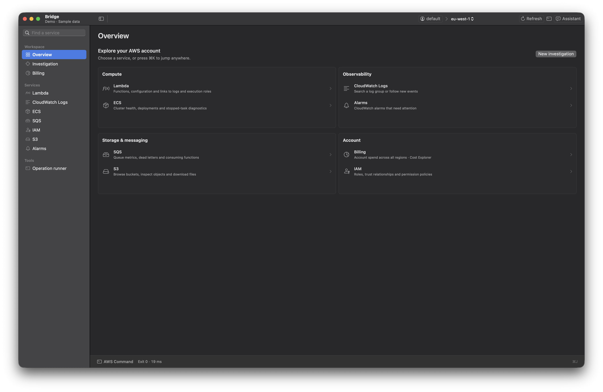

# Bridge

[](https://github.com/salilchincholikar/bridge/actions/workflows/checks.yml)

A native macOS workspace for AWS. Browse services, inspect logs, investigate workloads and understand account costs without losing your profile and region context.

Built with Swift, AppKit and hosted SwiftUI/Charts. Each native window tab keeps its own AWS context; a shared command drawer shows the requests behind the current view.



*Native capture of Bridge Demo with fictional data.*

**Status:** pre-release. Local builds and offline regression checks pass; hosted CI, broader real-account compatibility and downloadable-release signing are tracked separately. See the [validation record](docs/validation.md) and [release tracker](docs/open-source-readiness.md).

## What you can do

| Workspace | Capabilities |
|---|---|
| Overview | Find services and open a workspace with ⌘K |
| Investigation | Discover related resources around a workload name and save investigation definitions |
| Lambda | Browse functions, inspect configuration and follow links to logs/execution roles |
| CloudWatch Logs | Search log groups and events; follow with five-second polling |
| ECS and SQS | Inspect service/task health, queue attributes and related metrics |
| IAM, S3 and Alarms | Inspect roles/policies, browse/download objects and review CloudWatch alarms |
| Billing | Account-scoped spend across regions, daily chart, service totals, previous-period comparison and remaining-month forecast |
| Operation runner | Generate forms for explicitly supported, non-sensitive read operations |
| Assistant (experimental) | Optional Claude Code or Codex integration with provider-specific consent and visible read activity |

Billing loads only when requested. Cost Explorer must be enabled and permitted for the profile; API charges may apply. The runner's installed CLI models provide form metadata; the explicit policy table still decides which operations can run.

## Requirements

- **macOS:** deployment target 14 or later. Local validation is on Apple Silicon; Intel and the minimum OS need separate verification.
- **Build tools:** Swift tools 6.2 or newer. The local build has been verified with Swift 6.4 and Command Line Tools, without Xcode.app. The package currently uses Swift 5 language mode.
- **Real AWS use:** [AWS CLI v2](https://docs.aws.amazon.com/cli/latest/userguide/getting-started-install.html) and an existing named profile. Bridge discovers `/opt/homebrew/bin/aws` or `/usr/local/bin/aws`; `aws_path` in Bridge settings can select another installation.
- **Demo/offline checks:** no AWS credentials, installed AWS CLI or model-provider account required.

There is no published installer yet. Clone the source, then use the build commands below:

```sh
git clone https://github.com/salilchincholikar/bridge.git
cd bridge
```

## Try the demo

```sh
make demo-app
open "build/Bridge Demo.app"
```

The separate demo bundle contains invented profiles, resources, costs, operation models and fake provider executables. It does not call AWS or a model provider, and does not inspect your shared credentials file. Its window is labelled **Demo · Sample data**.

Use `make demo` to build and run it from a terminal. Public screenshots must come from this fictional dataset; real-account development captures must not be included in the repository.

## Use your AWS profiles

Configure a named profile with the AWS CLI and complete any required sign-in first, then:

```sh
make app
open build/Bridge.app
```

Choose a profile and region in the toolbar, then a destination in the sidebar. Select a resource to inspect its details. Profile discovery includes shared-credentials-only profiles. Bridge inspects helper/role-chain metadata for trust checks, discarding credential values from that parsed model.

A new or changed `credential_process` needs explicit human approval before the CLI can use it. **⌘,** opens Profile Settings for labels, default region, expected account and permission limits. Settings are written atomically; a corrupt file must be repaired before saving.

The command-line front end uses the same Core policy:

```sh
build/Bridge.app/Contents/MacOS/Bridge profiles
build/Bridge.app/Contents/MacOS/Bridge help
```

## Keyboard and command drawer

| Shortcut | Action |
|---|---|
| ⌘K | Jump to a service or tool |
| ⌘T | New native tab |
| ⌘R | Refresh current workspace |
| ⌘J | Open/close AWS Command |
| ⌘F | Focus page or service search |
| ⌘1 / ⌘2 / ⌘3 | Overview / Investigation / Billing |
| ⌘, | Profile Settings |
| ⌘⇧A | Assistant inspector |

The resizable AWS Command drawer shows bounded, memory-only request history, status, duration, copy and cancellation. Sensitive responses are omitted. History clears when context changes; use Operation runner for supported reads.

## Repository structure

```text
Sources/
├── BridgeCore/             # Configuration, policy, identity, execution, workflows and transfers
├── BridgeUI/               # Reusable native workspace layout and metric charts
├── BridgeAgents/           # Optional assistant harnesses, MCP and private IPC
└── BridgeApp/
    ├── Features/           # Billing, Lambda, Logs, ECS, SQS, IAM, S3, etc.
    ├── Navigation/         # Shared feature registry and destination factories
    ├── UI/                 # Window shell and remaining shared presentation
    ├── CLI.swift
    └── main.swift
Tests/BridgeCoreTests/      # Offline Core and integration suites
Fixtures/                  # Invented config/responses, fake executables and synthetic models
examples/BridgeClient/     # Independent Core consumer with an in-memory adapter
Resources/                 # App metadata, icon, credits and Help
scripts/                   # Build, asset, test and bundle checks
.github/                   # Prepared CI workflow, ownership and contribution templates
docs/                      # Architecture, security, development and release guidance
```

`BridgeCore`, `BridgeUI` and `BridgeAgents` are experimental SwiftPM library products. Core owns authorization and sensitive-result handling; the current execution adapter uses the AWS CLI. An in-memory adapter demonstrates reuse without credentials. No AWS Swift SDK backend is implemented yet.

Feature screens currently remain internal to the app target. Shared tables/inspectors, the window coordinator and test runner still need further decomposition. Historical `Spikes/` experiments are outside the production package and require review before public inclusion.

See [architecture](docs/architecture.md), [SDK usage](docs/sdk.md) and [UI reuse](docs/ui-components.md).

## Development and verification

```sh
make lint          # Curated assets, executable permissions and shell syntax
make test          # Offline Core and assistant integration checks
make example       # Independent Core consumer; entirely in memory
make verify-bundle # Check an already-built production bundle
make ui-test-app   # Build the dedicated GUI test bundle
```

Open `build/Bridge UI Checks.app` in an interactive macOS session to run the GUI suite. Results go to `/private/tmp/bridge-native-ui-checks.log`. `make ui-test` also runs it from a terminal with a GUI session. Production and ordinary demo builds exclude the test entry point.

`make check` runs the non-GUI aggregate checks. Build tasks run sequentially because they share `.build`. For toolchain/cache workarounds and CI details, see [development.md](docs/development.md).

## Security, privacy and current limits

Bridge runs as your macOS user outside App Sandbox. AWS requests use the selected profile under an explicit application policy; IAM remains the account's authoritative permission limit. Shell-exported AWS keys/profile/endpoint overrides are stripped from CLI execution.

Sensitive results are excluded from ordinary caching, assistant reads and command history. Masking/redaction is best effort and cannot detect every secret in arbitrary logs. Optional assistant results can leave your machine for the selected provider; read the disclosure before enabling it.

Current release work includes real-account/provider compatibility review, broader OS/accessibility QA, reviewed demo screenshots, a fresh-checkout CI run and Developer ID/notarization. Local ad-hoc signing is not a downloadable-release trust guarantee. The SDK interfaces are experimental.

Read the [security model](docs/security-model.md), [privacy notes](docs/privacy.md), [security reporting policy](SECURITY.md) and [release gates](docs/releases.md). Repository-specific private vulnerability reporting is pending maintainer setup; do not post credentials or exploit details in public issues.

## Contributing and license

See [CONTRIBUTING.md](CONTRIBUTING.md), [CODE_OF_CONDUCT.md](CODE_OF_CONDUCT.md) and the [readiness tracker](docs/open-source-readiness.md).

Licensed under the [Apache License, Version 2.0](LICENSE). Copyright © 2026 Salil Chincholikar. Adapted build-script attribution is retained in [NOTICE](NOTICE); app bundles include both files. Further source/asset provenance review remains part of publication preparation.

Made by [Salil Chincholikar](https://github.com/salilchincholikar). Bridge is independent software and is not affiliated with Amazon Web Services.
